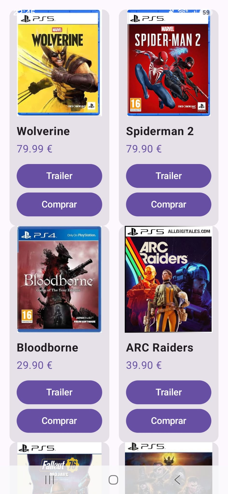

# Reto 2 · E-Commerce Adaptativo (Responsive UI)

**Módulo:** 0489 · Programación Multimedia y Dispositivos Móviles
**Autor:** [Tu Nombre y Apellidos]
**Tecnología:** Kotlin + Jetpack Compose (Android nativo)
**RA vinculado:** RA1 y RA2 · Interfaces adaptables y limitaciones del dispositivo

## 📱 Producto Final (Capturas)

### Móvil en vertical

*No hay una captura de tablet o de móvil en horizontal en `img/capturas/` todavía.*

## 🎯 Objetivo del reto
Comprender la fragmentación de pantallas en Android y resolver los problemas de visualización en distintos perfiles de dispositivos. Pasar de un diseño estático (una lista infinita que se deforma) a una interfaz *responsive* (una cuadrícula inteligente) utilizando componentes de Jetpack Compose que calculan el espacio disponible en tiempo real.

## 🛠️ Componentes y conceptos utilizados

| Componente / Concepto | Para qué se usa en esta app |
| :--- | :--- |
| **LazyVerticalGrid** | Sustituye a `LazyColumn` para crear una cuadrícula en lugar de una lista simple. |
| **GridCells.Adaptive** | Calcula automáticamente cuántas columnas caben en la pantalla indicando solo el tamaño mínimo por tarjeta. |
| **Card** | Crea un contenedor elevado y con bordes redondeados para agrupar la imagen y los datos de cada producto. |
| **ContentScale.Fit** | Muestra la imagen completa dentro del espacio asignado y conserva sus proporciones. |
| **maxLines & TextOverflow** | Fuerza a que los textos largos ocupen una sola línea y añade puntos suspensivos (`...`) para no descuadrar las tarjetas. |
| **Mock Data (Datos)** | Uso de una `data class` y una lista local para simular la información antes de conectar una base de datos real. |

## 🧐 Reflexión y Pensamiento Crítico

1. **Sobre la adaptabilidad:** ¿Por qué hemos usado `GridCells.Adaptive(minSize = ...)` en lugar de fijar el número de columnas con `GridCells.Fixed(2)`? ¿Qué ventaja tiene en el mundo real?
   > `Adaptive` calcula cuántas tarjetas caben según el ancho disponible y el tamaño mínimo elegido. Así el catálogo se ajusta a móviles, tablets y distintas orientaciones sin tener que fijar un número de columnas ni crear un diseño distinto para cada pantalla.

2. **Sobre el diseño UI:** ¿Qué ocurría con las tarjetas si el nombre de un producto era muy largo y ocupaba dos líneas mientras los demás ocupaban una? ¿Cómo lo hemos solucionado?
   > Si el nombre ocupaba varias líneas, las tarjetas podían tener alturas distintas y la cuadrícula quedar desalineada. Se limita el nombre a una línea con `maxLines = 1` y `TextOverflow.Ellipsis`, que muestra puntos suspensivos cuando no cabe.

3. **Sobre las imágenes:** ¿Por qué es importante usar `ContentScale.Crop` en la imagen del producto cuando cambiamos el ancho de la tarjeta al rotar la pantalla?
   > `Crop` llena el espacio de la imagen manteniendo sus proporciones; recorta el sobrante si hace falta, en vez de deformarla. En el código actual se usa `ContentScale.Fit`, que muestra la imagen completa, aunque puede dejar espacio libre dentro del área asignada.

4. **Visión de futuro:** Ahora mismo nuestros productos están escritos directamente en el código (*hardcodeados*). ¿Qué crees que necesitaría nuestra app en el futuro para que esta tienda mostrara productos reales de internet?
   > Necesitaría un servicio o API que proporcione el catálogo y una conexión a internet. La app tendría que solicitar los datos (por ejemplo, con Retrofit o Ktor), convertir la respuesta —normalmente JSON— en productos y gestionar estados de carga y errores. También sería útil guardar imágenes en caché.

## 🚀 Cómo ejecutar el proyecto
1. Clonar el repositorio y abrir en Android Studio.
2. Ejecutar (▶) primero en un emulador de móvil (ej. Pixel 6).
3. Girar la pantalla del móvil a horizontal o ejecutar en un emulador de Tablet para comprobar la adaptación de la cuadrícula.

## 🐞 Dificultades y cómo las resolví
*(Opcional: Si te atascaste en algo durante el reto, explica aquí qué fue y cómo lo solucionaste).*
- *[Explica aquí tu dificultad]*
