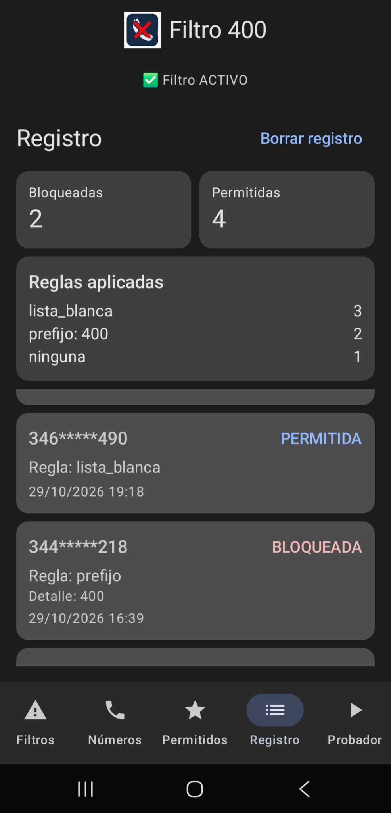
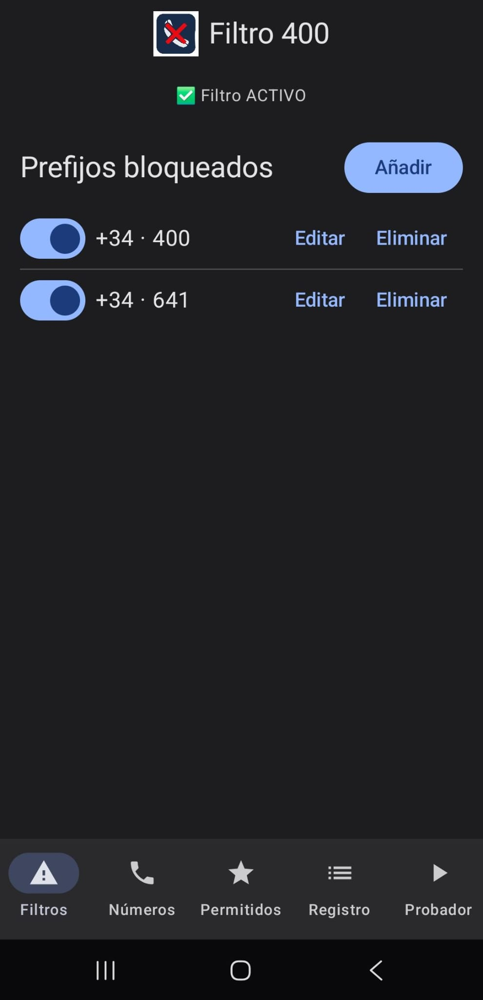
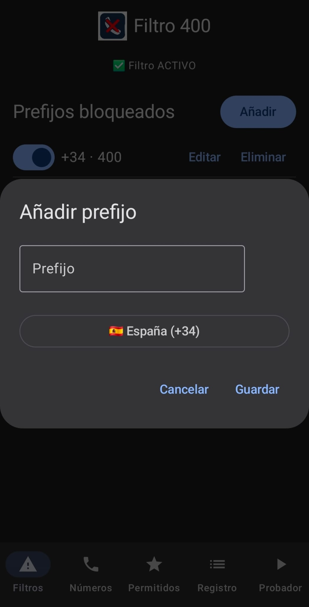
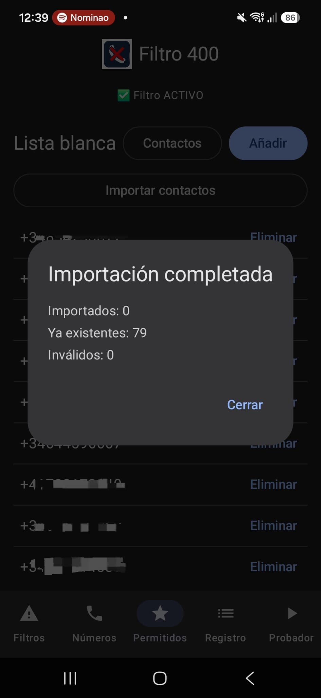
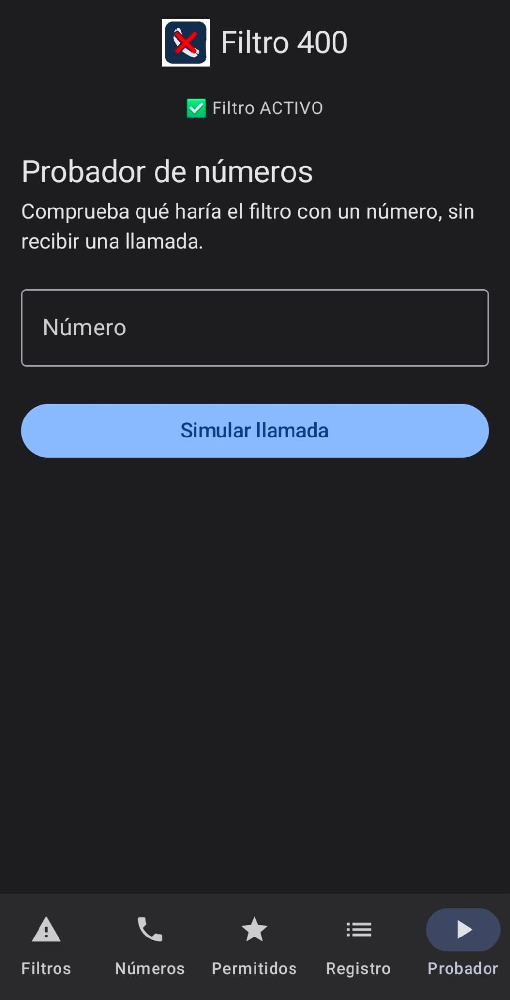

# Reto 03 - Filtro 400

## 4. Evidencias de las pruebas realizadas

### Pruebas automatizadas

El 4 de noviembre de 2026 se ejecutó:

```bash
./gradlew :app:testDebugUnitTest :app:assembleDebug
```

Resultado: **BUILD SUCCESSFUL**. Las 39 pruebas unitarias finalizaron sin fallos, errores ni omisiones:

| Suite | Pruebas | Resultado |
|---|---:|---|
| `CsvListasTest` | 7 | Correctas |
| `ExampleUnitTest` | 1 | Correcta |
| `MotorFiltradoTest` | 9 | Correctas |
| `NumeroUtilTest` | 7 | Correctas |
| `ReglaBloqueoTest` | 15 | Correctas |
| **Total** | **39** | **39 correctas, 0 fallos** |

Las pruebas cubren la evaluación de reglas y lista blanca, la normalización y el enmascarado de números, y el análisis y generación de archivos CSV.

Los informes XML generados por Gradle están en `app/build/test-results/testDebugUnitTest/`; los resultados legibles están en `app/build/reports/tests/testDebugUnitTest/`.

### Evidencias en un móvil físico

Las siguientes capturas se realizaron con la aplicación funcionando en un teléfono físico. Muestran el filtro activo, la gestión de prefijos, la lista blanca y la importación de contactos, el registro de decisiones y la pantalla para simular llamadas.

| Registro y estadísticas | Gestión de prefijos |
|---|---|
|  |  |

| Añadir prefijo | Lista blanca e importación de contactos |
|---|---|
|  |  |

| Probador de llamadas |
|---|
|  |

### Compilación

La tarea `:app:assembleDebug` finalizó correctamente y generó el APK de depuración en:

```text
app/build/outputs/apk/debug/app-debug.apk
```

### Alcance y pruebas pendientes

Las capturas documentan la app funcionando en un móvil físico y su interfaz; el registro muestra decisiones permitidas y bloqueadas con números enmascarados. Las pruebas automatizadas descritas arriba son unitarias y no sustituyen una prueba controlada de llamadas entrantes. Para validar el filtrado real, debe probarse en un teléfono compatible con la aplicación como rol de filtrado de llamadas y con números autorizados; Android puede limitar qué llamadas entrega al servicio.
